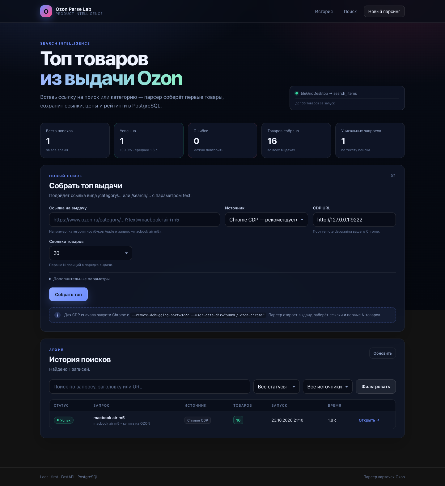
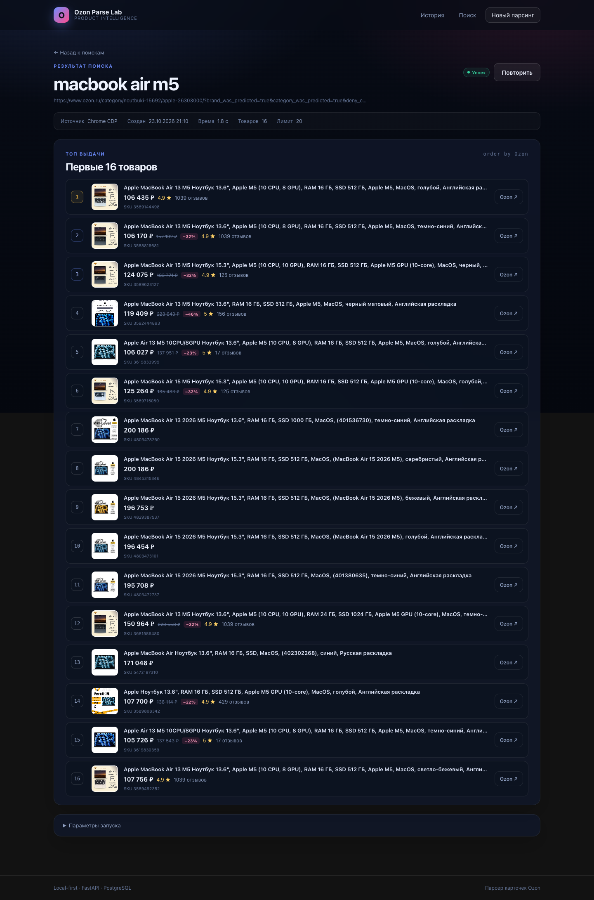

# EPARSE-3 — статус: топ товаров из поисковой выдачи Ozon

**Дата:** 2026-10-23  
**Проект:** `/Users/igor/Documents/test_project/ozon-parser`  
**Статус:** фича готова и проверена на живой выдаче.  
**Версия:** 0.4.0

---

## 1. Задача

Добавить отдельный режим: по ссылке на поиск/категорию Ozon собрать топ товаров
из выдачи, сохранить ссылки и данные товаров в PostgreSQL, показать историю
и результаты в веб-интерфейсе.

Пример:

```text
https://www.ozon.ru/category/noutbuki-15692/apple-26303000/?text=macbook+air+m5
```

Важно: не менять существующую логику парсинга карточек (`/runs`, `parse_runs`,
`ozon_parser.api`, `fetch_product_browser`).

---

## 2. Что сделано

- [x] Новый парсер поисковой выдачи `ozon_parser/search.py`.
- [x] Сбор товаров из `tileGridDesktop.items`.
- [x] Пагинация через `infiniteVirtualPaginator.nextPage`.
- [x] Дедупликация по SKU.
- [x] Лимит 1–100 товаров (по умолчанию 20).
- [x] Новые таблицы `search_runs` и `search_items` (не пересекаются с `parse_runs`).
- [x] Фоновый runner `search_runner` со статусами `queued/running/success/failed`.
- [x] JSON API: `/api/searches`, `/api/searches/{id}`, `/api/searches/stats`.
- [x] Веб-страницы `/searches` и `/searches/{id}`.
- [x] Отдельные `search.css` / `search.js`, навигация «Поиск».
- [x] Тесты: 39 всего, из них 10 на поисковый парсер и 4 на веб-поиск.
- [x] Живой прогон через CDP: 16 товаров за ~1.8–2.4 с.
- [x] Скриншоты.

### Скриншоты





---

## 3. Как работает

```text
Search URL
  → build_search_api_url()
  → Chrome CDP / Playwright открывает страницу выдачи
  → fetch(entrypoint-api...url=/category/...)
  → parse_search_json(): tileGridDesktop.items
  → nextPage → ещё страницы, пока не набрали limit
  → dedupe by SKU, position 1..N
  → search_runs + search_items
  → UI polling /api/searches/{id}
```

Что извлекается по каждому товару:

- позиция в выдаче;
- SKU;
- канонический `product_url` без tracking-query;
- название;
- цена, старая цена, скидка, валюта;
- рейтинг и число отзывов;
- изображение;
- полный JSON позиции в `search_items.raw`.

---

## 4. Запуск

```bash
cd /Users/igor/Documents/test_project/ozon-parser
docker compose up -d db
uv sync --extra browser
uv run uvicorn app.main:app --reload --port 8000
```

Chrome для CDP:

```bash
"/Applications/Google Chrome.app/Contents/MacOS/Google Chrome" \
  --remote-debugging-port=9222 \
  --user-data-dir="$HOME/.ozon-chrome"
```

Открыть `http://127.0.0.1:8000/searches`.

Пример API:

```bash
curl -X POST http://127.0.0.1:8000/api/searches \
  -H 'Content-Type: application/json' \
  -d '{
    "url": "https://www.ozon.ru/category/noutbuki-15692/apple-26303000/?text=macbook+air+m5",
    "source": "cdp",
    "limit": 20,
    "timeout": 45,
    "challenge_timeout": 120
  }'
```

Ответ:

```json
{"id": "…", "status": "queued"}
```

Дальше: `GET /api/searches/{id}`.

---

## 5. API

| Метод | Путь | Назначение |
|---|---|---|
| `POST` | `/api/searches` | Создать сбор топа |
| `GET` | `/api/searches` | История: `status`, `source`, `q`, `limit`, `offset` |
| `GET` | `/api/searches/{id}` | Детали + список товаров |
| `GET` | `/api/searches/stats` | Статистика |
| `GET` | `/searches` | HTML-страница |
| `GET` | `/searches/{id}` | HTML-детали |

---

## 6. Модель данных

### `search_runs`

- `id` UUID;
- `search_url`, `query`, `title`;
- `source`, `status`;
- `created_at`, `started_at`, `finished_at`, `duration_ms`;
- `items_count`;
- `options` JSONB;
- `error`.

### `search_items`

- `id` UUID;
- `search_run_id` FK → `search_runs.id` (cascade delete);
- `position`;
- `sku`, `product_url`, `name`;
- `price`, `original_price`, `currency`, `discount`;
- `rating`, `review_count`;
- `image_url`;
- `raw` JSONB.

Уникальность: `(search_run_id, position)`, индекс по `sku`.

---

## 7. Проверка

### 7.1. Тесты

```bash
uv run python -m unittest discover -s tests -v
```

- **39 тестов**, все проходят.
- `tests/test_search_parser.py` — 10 тестов поискового JSON и URL.
- `tests/test_web_app.py` — 11 тестов, включая 4 поисковых сценария.
- `tests/test_parser.py` — 18 тестов старого парсера (переведены на `tests/fixtures/product_response.json`).
- `ruff check` и `ruff format --check` — чисто.

### 7.2. Живой прогон

Через веб-приложение с PostgreSQL:

```json
{
  "query": "macbook air m5",
  "items_count": 16,
  "duration_ms": 1842,
  "error": null
}
```

Первые позиции:

| # | SKU | Цена | Рейтинг |
|---|---|---|---|
| 1 | 3589144498 | 106 435 ₽ | 4.9 |
| 2 | 3588816681 | 106 170 ₽ | 4.9 |
| 3 | 3589623127 | 124 075 ₽ | 4.9 |
| 4 | 3592444893 | 119 409 ₽ | 5.0 |

Для этого запроса Ozon отдал 16 уникальных товаров; парсер прошёл 2 страницы
выдачи и остановился, когда `nextPage` закончился.

Полный пример ответа API: [sample-search-result.json](sample-search-result.json).

### 7.3. PostgreSQL

Проверено:

```bash
docker exec ozon-parser-db-1 psql -U ozon -d ozon -c '\dt'
```

Таблицы `search_runs` и `search_items` создаются, `options`/`raw` — `jsonb`,
FK с `ON DELETE CASCADE`, индексы на месте.

### 7.4. UI

Проверено скриншотами и браузерным сценарием: форма → POST → `/searches/{id}` →
polling → список товаров с ценами, скидками и рейтингами.

---

## 8. Ограничения

1. **Только выдача.** Мы сохраняем данные из плитки поиска, но не открываем каждую
   карточку отдельно. Для полного описания/характеристик нужен отдельный запуск
   `parse_runs` по `product_url`.
2. **Лимит Ozon.** Для запроса может быть доступно меньше товаров, чем `limit`;
   сохраняется столько, сколько реально отдал Ozon.
3. **Только CDP/Playwright.** Прямой HTTP к поисковому API, как и к товарному,
   упирается в антибот.
4. **Docker.** В контейнере нет Playwright/Chrome; CDP из контейнера к хосту
   обычно недоступен. Для поиска запускайте приложение локально.
5. **Нет периодического мониторинга.** Это разовый запуск, не scheduler.
6. **Нет истории цен по SKU.** Каждый запуск — снимок; сравнение между запусками
   пока не сделано.
7. **Нет auth.** Приложение локальное.

---

## 9. Следующие шаги

### P0

- [ ] Обогащение топ-N: запускать `parse_runs` по каждому `product_url`.
- [ ] Сравнение двух поисковых запусков (позиции, цены).
- [ ] Экспорт `search_items` в CSV/JSON.

### P1

- [ ] История цен по SKU (snapshots).
- [ ] Периодический запуск (scheduler) и алерты по цене.
- [ ] Загрузка сохранённого JSON выдачи в UI.
- [ ] Фильтры по цене/рейтингу/скидке.

### P2

- [ ] RQ/Celery для очереди поисков.
- [ ] Alembic для `search_runs`/`search_items`.
- [ ] Auth и ограничение доступа.

---

## 10. Handoff

1. `docker compose up -d db` — healthy?
2. Chrome с `--remote-debugging-port=9222` запущен?
3. `uv run uvicorn app.main:app --port 8000` — `/health` ok?
4. `GET /searches` открывается?
5. POST `/api/searches` по примеру → `success` и `items_count > 0`?
6. `search_items` содержит позиции 1..N?
7. Старый `/` и `/runs/{id}` не сломаны?
8. `uv run python -m unittest discover -s tests` — 39 тестов?

---

## 11. Определение готовности

- [x] Поиск по `/category/...` и `/search/...`.
- [x] Сбор ссылок и полей товаров.
- [x] Пагинация и дедупликация.
- [x] Сохранение в PostgreSQL.
- [x] История, статистика, детальная страница.
- [x] Фоновый runner и polling.
- [x] Тесты и линтер.
- [x] Живой прогон.
- [x] Документация и скриншоты.
